<p align="center">
  <picture>
    <source media="(prefers-color-scheme: dark)" srcset=".github/assets/quranlab-mark-dark.svg">
    <source media="(prefers-color-scheme: light)" srcset=".github/assets/quranlab-mark-light.svg">
    
  </picture>
</p>

<h1 align="center"><picture><source media="(prefers-color-scheme: dark)" srcset="docs/banner-dark.svg"></picture></h1>

<p align="center">Give your iPhone, iPad and Mac app an ear for tajweed. It follows the learner word by word and shows the one to fix: offline, on the device, and free.</p>

<p align="center">
  <a href="https://github.com/Quran-Lab/tajweedformer-apple/actions/workflows/ci.yml"></a>
  
  
  
</p>

## What you get

<table>
<tr>
<td width="33%" valign="top">

**Hears every word**<br>Streaming recognition of Quranic recitation while the learner recites. Results arrive as often as every 160 ms on the CPU engine (320 ms by default, including on the Neural Engine; 480 ms for longer context).

</td>
<td width="33%" valign="top">

**Points to the word to fix**<br>Wrong letters and vowels, madd held too short or too long, and a score for every word. Qalqalah checks are experimental.

</td>
<td width="33%" valign="top">

**Native on Apple**<br>A Swift Package for iOS 15+ and macOS 12+. On iOS 18+ and macOS 15+ it runs on the Neural Engine, with the exact CPU engine as fallback.

</td>
</tr>
<tr>
<td valign="top">

**Private by default**<br>Offline, on the device. A recording leaves it only when the learner agrees to share it.

</td>
<td valign="top">

**Nothing to host**<br>The SDK downloads the right model for each device (from about 57 MB) from our CDN in six regions, verifies it and keeps it up to date.

</td>
<td valign="top">

**Tuned in the portal**<br>Four presets and three word levels. Change them at any time; your app picks them up without a new build.

</td>
</tr>
</table>

### Strict or gentle: you choose

**Strict** almost never flags a correct recitation. **Balanced** is the default. **Sensitive** catches more, and **Very sensitive** catches the most, for a teacher who reviews every flag first. The word level follows your learners: **strict** for huffaz and advanced students, **general** for most apps, **beginner** for children and classes.

## Why TajweedFormer

- **Made for the Quran.** Your app names the ayah; TajweedFormer checks the recitation against it, sound by sound, and gives every word its own verdict.
- **Feedback in the moment.** Results stream while the learner recites, so your app can respond on the word itself, not after the take.
- **One engine on every platform.** The same engine runs the [iOS and macOS](https://github.com/Quran-Lab/tajweedformer-apple), [Android](https://github.com/Quran-Lab/tajweedformer-android), [web](https://github.com/Quran-Lab/tajweedformer-web) and [Windows and Linux](https://github.com/Quran-Lab/tajweedformer-c) SDKs, all set from one portal.
- **Free, and it stays free.** Quran Lab is a non-profit waqf: the SDKs and models are never sold. The licence, NPL-1.2, asks three things: no paywall on model features, no results presented as rulings, and show the notice.

## Built for AI developers

Copy the setup prompt from [portal.quranlab.ai](https://portal.quranlab.ai) and paste it into your coding assistant. That one prompt sets everything up: the package, your key, and the settings for the learners your app is for. [AGENTS.md](AGENTS.md), beside this README, gives the assistant the complete API, so the code it writes uses names that exist. Prefer to do it by hand? Get a key in the portal and start below.

## Quick start

```swift
import TajweedFormer

QuranLab.configure(key: "qlk_v1_...", options: .init(contributions: true))   // once, at launch

let model = try await TajweedModel.load()          // this device's download profile, verified
let r = try TajweedRecognizer(model: model, options: TajweedOptions(preset: .balanced, word: .general))

try await r.startTake()
for chunk in try await r.append(samples, sampleRate: 48_000) {   // raw layer, as audio arrives
    print(chunk.index, chunk.heads[.logProbs].count)
}
try await r.finish()

let heard = await r.decoded()                      // decoded layer
print(heard.transcript, heard.tokens.map(\.confidence))

let result = try await r.score(surah: 1, ayah: 2)  // tajweed layer
for w in result.words where w.flagged == true { print("word", w.index, w.score!) }
for s in result.flagged { print(s.cls, s.expected as Any, s.alternative as Any, s.llr, s.threshold) }

await r.endSession(feedback: true)                 // the moment the SDK may ask about sharing
```

With a microphone: `try Microphone().start(into: r)` after `startTake()`, and `for await c in await r.chunks()` for
the chunks as they complete. Every error is a `RecognizerError`.

## More

The full reference (every layer of the API, backends, what a device downloads, platform settings, recording sharing, building and testing) is in [AGENTS.md](AGENTS.md), written for coding assistants and just as readable for you. Guides: [portal.quranlab.ai/docs](https://portal.quranlab.ai/docs).

## Licence

Quran Lab is a waqf: the SDKs and the models are free to use and are never sold.

The source code in this repository and the TajweedFormer model weights are released under the
Quran-Lab No-Profit License 1.2 ([NPL-1.2](LICENSE)): use, copy, modify and build on them freely,
but never charge for them, for access to them, or for any feature they power. The weights are not
stored in this repository; Quran Lab hosts them itself and serves them to apps by
`cdn.quranlab.ai/models` under the same licence. Request access at
[portal.quranlab.ai/access](https://portal.quranlab.ai/access).

Third-party components keep their own licences, listed in their folders under `third_party/`.
